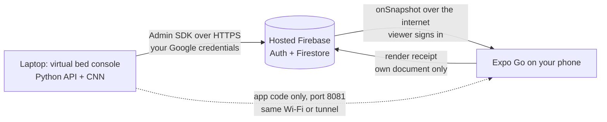

# Run the app on your phone

**Physical-phone status: verified on 21 November 2026.** An iPhone 17 Pro Max (iOS 26.6.2, Expo Go, SDK 58) signed in to the hosted project, drew frames `virtual-bed/27` to `68` while the person moved, rolled, got up and lay down again, and was at most one frame behind. Its CNN estimate changed in step with each action, it showed Stale when transmission paused, and it returned to Live on resume. The owner watched the phone throughout. Firestore recorded each receipt with `physical_device: true`. [Run log](evidence/interactive/physical-phone.json)

## How the pieces connect



Readings never travel from the laptop to the phone directly. Python writes each frame to your hosted Firestore, and the phone subscribes to it over the internet after signing in. The laptop's only direct link to the phone is the Expo development server, which hands Expo Go the app's JavaScript.

On the phone, `127.0.0.1` means the phone itself, so the local emulators on the laptop are unreachable from it. That is why the phone route uses a hosted Firebase project. The emulators stay bound to the laptop and remain the private, offline route for laptop-only demos.

## What you need

- The laptop with `scripts\setup.cmd` already run.
- A Google account that can create a Firebase project. The free **Spark** plan is enough. Do not add billing.
- Your phone with **Expo Go** installed from the App Store or Google Play. The app uses Expo SDK 58, which the current Expo Go supports.
- Phone and laptop on the same home Wi-Fi, or use the tunnel option in step 9. The verified run used the tunnel because the laptop was on eduroam.

## Part 1. Firebase console (about 10 minutes)

1. **Create a project.** Open <https://console.firebase.google.com>, click **Create a project**, name it, for example `textilesense-live`, and continue. Turn **Google Analytics** off. Click **Create project**. Note the **Project ID** Firebase shows. It may have a suffix such as `textilesense-live-4f2a1`.
2. **Stay on Spark.** The plan badge next to the project name should read *Spark*. Every limit in this demo fits the free quota.
3. **Create the database.** In the left menu choose **Build → Firestore Database → Create database**. Pick **Standard edition**, keep the database ID `(default)`, choose the location nearest to you (it cannot be changed later), select **Start in production mode**, and click **Create**.
4. **Turn on email sign-in.** Choose **Build → Authentication → Get started → Sign-in method → Email/Password**. Switch on the first toggle only and click **Save**.
5. **Register the web app.** Click the gear icon → **Project settings → General**. Under **Your apps** click the web icon `</>`. Name it `textilesense-phone`, leave Firebase Hosting unticked, and click **Register app**. From the configuration shown, copy `apiKey` and `projectId`. This web API key only identifies the project to the Firebase SDK. Access is controlled by sign-in and the security rules, not by keeping this key secret.

## Part 2. Laptop setup (one time)

Run these in **PowerShell** or **Command Prompt** from the repository folder.

6. **Fill in the project settings.**

   ```powershell
   copy hosted.env.example hosted.env
   notepad hosted.env
   ```

   | Variable | Value | Where it is used |
   |---|---|---|
   | `TEXTILE_PROJECT` | The Project ID from step 1 | Python API, console, setup tool |
   | `EXPO_PUBLIC_API_KEY` | `apiKey` from step 5 | Phone app (public client setting) |
   | `GOOGLE_APPLICATION_CREDENTIALS` | Optional path to a service-account key | Only if you skip step 7 |

   `hosted.env` and `mobile/.env.local` are ignored by git.

7. **Let Python act on your project.** The Admin SDK uses Google Application Default Credentials. Sign in with the Google account that owns the project. A browser window opens for consent.

   ```powershell
   gcloud auth application-default login
   ```

   ```powershell
   gcloud auth application-default set-quota-project YOUR_PROJECT_ID
   ```

   The credentials are stored in your Windows profile, outside the repository. *Alternative:* in **Project settings → Service accounts → Generate new private key**, save the JSON outside the repository and set `GOOGLE_APPLICATION_CREDENTIALS` to its full path in `hosted.env`. Treat that file like a password.

8. **Provision rules, viewer and session.**

   ```powershell
   scripts\hosted-setup.cmd
   ```

   Enter an email for the phone's viewer account, then choose its password (at least 8 characters, typed hidden). The tool will:

   - publish `firestore.rules` to your project,
   - create the viewer in Firebase Authentication, or reuse an existing one with that email,
   - create `devices/virtual-mat-01` and `sessions/virtual-bed` with the viewer's UID in `readers`,
   - write `mobile/.env.local` with `EXPO_PUBLIC_PROJECT_ID`, `EXPO_PUBLIC_API_KEY`, `EXPO_PUBLIC_SESSION=virtual-bed` and `EXPO_PUBLIC_VIEWER_EMAIL`.

   If it reports that the rules could not be published, open **Firestore Database → Rules**, replace the text with the contents of [firestore.rules](firestore.rules), and click **Publish**.

## Part 3. Every demo

Use two terminals.

9. **Terminal 1, the bed:**

   ```powershell
   scripts\virtual-bed-hosted.cmd
   ```

   It checks the project, credentials and session first, then prints `Virtual bed console: http://127.0.0.1:8775`. Open that address on the laptop.

   **Terminal 2, the phone app:**

   ```powershell
   scripts\phone.cmd
   ```

   A QR code appears. On an iPhone, scan it with the Camera app. On Android, open Expo Go and tap **Scan QR code**. If Windows asks whether Node.js may use the network, allow **Private networks**. If the phone shows *Could not connect to the server*, the Wi-Fi is probably blocking device-to-device traffic, which is common on campus networks. Stop with Ctrl+C and run:

   ```powershell
   scripts\phone.cmd --tunnel
   ```

10. **Sign in on the phone** with the viewer email and password from step 8.
11. **Start transmitting** in the laptop console. Drag the mat and the person onto the bed. On the phone you should see the frame number climb about once a second and the heatmap follow the person.

Tips for recording: set the iPhone to **Settings → Display & Brightness → Auto-Lock → Never** while you film. iOS pauses Expo Go when the phone locks, and the app then catches up when you unlock it. The app remembers your sign-in, so reloading does not ask for the password again.

**Driving the demo from the phone:** the **Stream controls** card at the top of the Live tab has **Play**, **Pause** and **Play all unseen recordings**, which tours real recordings of three people the CNN never trained on. **Choose source** switches back to the virtual bed or plays one recording. See [VIRTUAL_BED.md](VIRTUAL_BED.md#control-it-from-the-phone) for how these requests are checked.

## How to confirm a physical phone received each frame

- In the console, step 5 of **Signal chain for this frame** reads like *iPhone 15 (physical phone) is showing frame 212, 380 ms after commit*.
- **Diagnostics → Phones displaying this session** lists the device with *physical*.
- In the Firebase console, **Firestore Database → Data → sessions → virtual-bed → viewers → (UID)** shows `frame_id`, `physical_device: true` and a server-stamped `rendered_at`. The value changes every second.

## Security rules in plain words

[firestore.rules](firestore.rules):

- Only a signed-in user whose UID is in `sessions/virtual-bed.readers` can read that session's `state`, `events` and `viewers`.
- No app user can write readings. Python writes through the Admin SDK, which Firebase trusts as the server.
- A viewer may write exactly one document, `viewers/{their own UID}`, with a fixed set of fields, and `rendered_at` must equal the server's request time. A phone cannot invent when it displayed a frame.
- A viewer may also write `controls/{their own UID}` to ask the laptop to start, pause or change source. Only the actions `start`, `pause` and `source`, the persons 11–13 and the three postures are accepted, with a server-stamped time. The laptop ignores requests older than its own start.

## Quota and cost

Each frame costs two writes (latest and history), one read for the console's check, about two listener reads per phone, and one receipt write per phone. One frame per second for ten minutes is about 1,800 writes. The free tier allows 20,000 writes a day. Each press of **Start transmitting** stops itself after 900 frames (15 minutes).

## Troubleshooting

| Symptom | Fix |
|---|---|
| `hosted check` says no Google credentials | Repeat step 7 in a new terminal. |
| `Firestore is not reachable` | Step 3 was skipped, or `TEXTILE_PROJECT` has a typo. |
| Phone: *Sign-in failed* | Wrong password, or Email/Password is off (step 4). |
| Phone: *This account cannot read the session* | Run step 8 again with the same email to add it to `readers`. |
| Phone stuck on *Waiting* | Press **Start transmitting** in the console and place the mat on the bed. |
| Laptop browser hangs on `http://127.0.0.1:8775` | Open `http://localhost:8775` instead. Some Edge and Chrome settings stall on the numeric address. |
| Phone shows *Cannot find native module* after an update | Stop `scripts\phone.cmd` with Ctrl+C, run it again, close Expo Go fully and scan the new QR code. This happens if packages change while Expo is running. |
| Phone stops updating | The phone locked or Expo Go went to the background. Unlock it, and turn Auto-Lock off while recording. |
| Expo Go cannot load the app | Use `scripts\phone.cmd --tunnel`, or set the Wi-Fi profile to Private (`Get-NetConnectionProfile`). |
