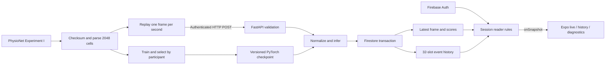

# TextileSense Live

Drag a pressure mat and a person onto a virtual bed on your laptop. A contact model turns the person's position and posture into 2,048 simulated pressure readings in mmHg. Python validates each frame, a trained PyTorch CNN estimates the posture from the grid alone, Firestore stores the frame and its result together, and an Expo app on your phone shows the heatmap and every metric live.

```
Person movement → virtual sensor readings → Python validation → CNN inference → Firestore → Expo app on the phone
```

A second source, switchable live from the laptop or the phone, streams **real recordings of three people the CNN never trained on**, with the dataset's label shown beside the model's estimate.

**Verified on a physical iPhone** (Expo Go, hosted Firebase) on 21 November 2026, alongside 19 simulator checks, 7 API and security-rule checks, and a 26-step browser acceptance run. Pressures are simulated, and the CNN's known limits are measured and shown in the app. This is a monitoring prototype, not a clinical tool.

[Interactive bed guide and demo script](VIRTUAL_BED.md) · [Phone setup with Firebase console steps](PHONE.md) · [Console walkthrough video](evidence/interactive/acceptance-console.webm) · [Phase-one replay demo](evidence/live_test/demonstration.mp4) · [Interview questions](QUESTIONS.md)

## Quick start on Windows

Install 64-bit Python 3.12 with the `py` launcher, Node.js 24 with npm, and JDK 21. In **PowerShell** or **Command Prompt**, from the cloned folder:

```powershell
scripts\setup.cmd
```

Laptop only, with local Firebase emulators:

```powershell
scripts\virtual-bed.cmd
```

Then open <http://127.0.0.1:8775>. To use your phone, follow [PHONE.md](PHONE.md) once, then run `scripts\virtual-bed-hosted.cmd` and `scripts\phone.cmd` in two terminals.

Tests:

```powershell
.venv\Scripts\python.exe -m pytest -q test_simulator.py
```

With the local bed running, `test_interactive.py` and `python -m proof.interactive_acceptance` exercise the API, Firestore and the console end to end. `python -m proof.model_behavior` regenerates the CNN behaviour sweep.

On macOS or Linux, use `bash scripts/setup.sh` and `bash scripts/virtual-bed.sh` (add `--hosted` for a hosted project).

## Make your own recording

On Linux or macOS install Python 3.12, Node 24 with npm, Java 21 and FFmpeg. From the project directory run:

```bash
bash scripts/setup.sh
bash scripts/record.sh
```

Setup installs the dependencies, builds the app and downloads the browser. Recording starts disposable local emulators, creates a viewer, starts Python and a local web server, runs one continuous take, and saves a **new** video in recordings/. On Linux, Playwright may prompt for system libraries. A fresh run needs the emulator ports available. For already-running emulators supply the existing viewer password through DEMO_PASSWORD and run `bash scripts/record.sh --running-emulators`. The distributed data and checkpoint allow recording without a training run. See the [iPhone procedure](PHONE.md) for the private device route.



## Reproduce on one computer

Use Python 3.12, Node 24, Java 21, npm, curl and a POSIX shell. The tested runtime versions are in the lockfiles and requirements. CPU PyTorch installs separately. Use the project root as your working directory. The project includes the 39 verified input files, model, reports, and screenshots.

```bash
python3 -m venv .venv
source .venv/bin/activate
python -m pip install torch==2.15.0 --index-url https://download.pytorch.org/whl/cpu
python -m pip install -r requirements.txt
npm ci
(cd mobile && npm ci)
# Optional checksum-verified refresh from PhysioNet
python dataset.py
# Optional training and independent feature baseline
python train.py
python forest.py
```

Start a clean local emulator in terminal A. It uses an in-memory demo project. The CLI downloads the emulator on first launch.

```bash
npx firebase emulators:start --only firestore,auth --project demo-textilesense
```

In terminal B, activate the Python environment. Generate a local sensor token, set a local viewer password, and start the backend. The rules proof uses a separate disposable session and viewer. Keep the token in your shell and start the backend as a background child so replay inherits the same token.

```bash
source .venv/bin/activate
node proof/listener.mjs
export TEXTILE_TOKEN="$(python -c 'import secrets; print(secrets.token_hex(32))')"
read -rs -p 'Choose a local viewer password (8+ characters): ' DEMO_PASSWORD
export DEMO_PASSWORD
python provision.py
python -m uvicorn api:app --host 127.0.0.1 --port 8000 &
```

In terminal C, export and serve the Expo app. Open http://127.0.0.1:8765 and sign in as viewer@example.test with the password you chose.

```bash
(cd mobile && npx expo export --platform web)
python3 -m http.server 8765 --directory mobile/dist --bind 127.0.0.1
```

In terminal B, run `python replay.py --pause`. It replays 36 real S11 frames from three recordings, pausing after supine. History keeps the newest 32. For a second replay, use `--start N` with the last sequence plus one. For a clean demo, restart the emulator and provision the viewer again. A sequence already used for another payload returns HTTP 409.

### Automated checks

```bash
python -m pytest -q test_pipeline.py
python -m proof.benchmark
# Requires Chromium at /usr/bin/chromium and the exported app served on 8765
python -m proof.dashboard
(cd mobile && npx tsc --noEmit && npx expo export --platform ios --output-dir /tmp/textilesense-ios)
```

The dashboard check appends to the demo. The benchmark and pytest use distinct temporary sessions. The emulator proof and tests use disposable local identities. Keep emulator ports bound to loopback.

## Data and inference

M. Baran Pouyan, J. Birjandtalab, M. Heydarzadeh, M. Nourani and S. Ostadabbas, *A pressure map dataset for posture and subject analytics*, IEEE BHI 2017. PmatData v1.0.0 is publicly accessible under Open Data Commons Attribution License v1.0. Credit the original contributors when redistributing the records or derivatives. PhysioNet is the distributor. [Dataset and license](https://physionet.org/content/pmd/1.0.0/) · [Publication](https://doi.org/10.1109/BHI.2017.7897206)

Experiment I covers 13 adults, eight standard postures and nine additional states. Its position table in experiment-info.docx identifies 1 as Supine, 2 as Right and 3 as Left, on a flat bed. We use precisely these three positions for all 13 people. Experiment II uses different hardware and dimensions. Files contain varying numbers of frames. Each tab-delimited row reshapes to 64 lengthwise samples by 32 crosswise samples, then transposes to model shape 32 × 64. The app reverses that display transpose. The source has no absolute capture timestamps. Recording ID and zero-based row preserve identity and nominal relative seconds at 1 Hz. The wire capture timestamp is the replay clock. The parser preserves every row. Outliers reach 4095 despite the nominal 0–1000 range. The model clips at 1000 and applies log1p divided by log1p(1000). Raw values remain inspectable. Display colors use a separate logarithmic scale saturated at 500.

One HTTP frame includes schema version, device, session, sequence, capture time, recording, source row, shape and 2048 integer readings. See the typed contract in [api.py](api.py) and the exact [sample request and snapshot](evidence/example.json). Inference loads the checkpoint once. A Firestore transaction verifies the device/session binding, advances sequence counts, and writes latest and history atomically. Sequence begins at zero. The latest document retains cumulative gap counts. A late arrival never rewinds the dashboard. Exact repeated payloads within the history window count as duplicates. Older repeats outside the window count as out of order. Same-sequence conflicting payloads within the window return 409. Retries reuse the original timestamp and values.

The optional [single-channel sensor extension](hardware/README.md) includes a separate API, a tested software simulation and a bench plan for an ESP32.

## Cloud and iPhone handoff

The verified environment has no Google Application Default Credentials or specified Firebase project. Use an existing approved **Spark** project with Firestore and email/password Auth. An operator with project configuration and Firestore rules deployment permission must deploy firestore.rules, create a viewer account, and seed sessions/demo with device = mat01 and readers = [the viewer UID]. Create devices/mat01 as described in provision.py. Supply the backend a short-lived ADC identity with Firestore data read/write permission, via the cloud credential manager. Set TEXTILE_PROJECT to the approved project ID. Unset emulator host variables for hosted access. Keep the API on loopback for replay. Use a separate operator identity for rules deployment. A public Firebase app configuration identifies the project. The private ingestion token stays server-side.

Set EXPO_PUBLIC_PROJECT_ID and EXPO_PUBLIC_API_KEY in the mobile build environment. Run `cd mobile && npx expo start` on a computer reachable by the iPhone, and open the QR code in an Expo Go release supporting SDK 58. Using hosted Firestore avoids forwarding any emulator ports. Verify two changing frame IDs, pause/recovery and authorization on the phone. Standalone distribution additionally needs an authorized signing and distribution workflow. No EAS job has been submitted.

Each accepted frame uses two document writes plus transactional reads. At 1 Hz this would generate 172,800 writes/day if left running. The 36-frame replay uses 72 frame writes plus setup. Listeners generate reads and the initial history subscription reads at most 32 documents. Retention limits storage, while the capped replay limits operations. Maps use a flat integer array, comfortably below Firestore's 1 MiB document maximum. Confirm current free quotas in the selected project before any hosted run. [Firestore pricing](https://firebase.google.com/docs/firestore/pricing) · [Limits](https://firebase.google.com/docs/firestore/quotas) · [Expo Firebase guide](https://docs.expo.dev/guides/using-firebase/)

## Model release procedure

Archive the existing checkpoint with its SHA-256 digest, results, dataset manifest, splits and training code. Train candidates separately. Review validation macro-F1, each recall, performance by participant and integration latency before promotion. Keep an additional untouched participant cohort for future release decisions after repeated use of this test set. Assign a new model version to each release. Point TEXTILE_MODEL to the approved artifact, restart the API, and check the model version and scores on a fixed input. Roll back by restoring the prior path and restarting. Each stored frame records the version used. Human-reviewed posture annotations, recording provenance and participant-separated evaluation would be prerequisites for future feedback training. Using predictions as labels could reinforce systematic errors.
